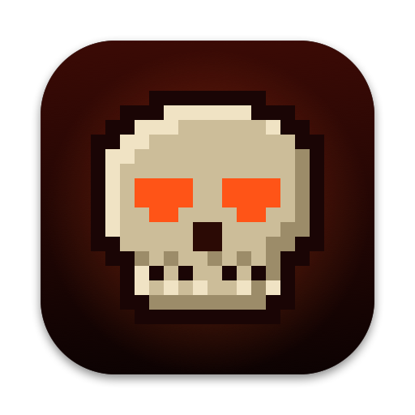

<p align="center">
  
</p>

<h1 align="center">MetalDoom</h1>

<p align="center"><b>The original DOOM, native on Apple silicon Macs.</b></p>

<p align="center">
  The 1993 engine and its rules, drawn with Metal at your display's full resolution, with smooth motion,
  gore and DualSense haptics. Bring your own <code>DOOM.WAD</code>.
</p>

<p align="center"><b>MetalDoom 1.0.0</b></p>

<p align="center">
  <a href="https://github.com/erhansavas/MetalDoom/actions/workflows/ci.yml"></a>
  <a href="https://github.com/erhansavas/MetalDoom/releases/latest"></a>
  <a href="LICENSE"></a>
  
</p>

> **Game data:** MetalDoom includes no game data. You need `DOOM.WAD` from your own copy of DOOM or
> The Ultimate DOOM, or `DOOM1.WAD` from the free shareware release. DOOM II, Final DOOM and add-on WADs
> are not supported.

## Features

- **The original game:** the same rules and the same demos.
- **Sharp and smooth:** your display's full resolution and frame rate (60 fps on most Macs, 120 fps on
  ProMotion displays), including the full notched screen.
- **Adaptive resolution:** when a frame would miss the display (a heavy scene, a hot Mac, Low Power Mode),
  the view is rendered smaller and filtered smoothly, then climbs back to full size.
- **Status bar card:** the original status bar as a compact, pixel-perfect card at the foot of the screen.
- **Gore:** blood that sprays, splatters and drips on walls, floors and ceilings, footprints, fragments,
  hit reactions with physics, and its own sounds. Built outside the game engine and spread over every CPU
  core, heavy gore never slows the game. Purely cosmetic: it never changes the game or its demos.
- **Game controllers:** DualSense haptics and adaptive triggers with recoil and resistance for each weapon;
  Xbox, DualShock and other controllers work too. The menus show the buttons of the controller you use.
- **Quick to play:** the game opens on its menu; Skip Transitions leaves out the screen melt and the level
  tally.

## Install

MetalDoom runs on Apple silicon Macs (M1 and later) with macOS 13 Ventura or later. Nothing else to install.

1. From [Releases](https://github.com/erhansavas/MetalDoom/releases/latest), download
   `MetalDoom-1.0.0-macOS-arm64.dmg`, open it and drag **MetalDoom** to the **Applications** folder.
2. The app is free and not notarized by Apple, so macOS blocks its first launch: choose **Done**, open
   **System Settings › Privacy & Security**, scroll down and choose **Open Anyway**. You only do this once.
3. On first launch MetalDoom looks for `DOOM.WAD` in `~/Library/Application Support/MetalDoom/` and in the
   usual Steam folders, or asks you to select it. Your file stays where it is; MetalDoom remembers it.

To verify the download: `shasum -a 256 -c MetalDoom-1.0.0-macOS-arm64.dmg.sha256`

Your saves are kept in `~/Library/Application Support/MetalDoom/`.

## Controls

The game starts fullscreen. Everything else is in the menu (**Esc**): video, controls, controller and
audio settings, and Skip Transitions under Video.

| Keyboard and mouse | |
| --- | --- |
| **W A S D** or arrow keys | Move and strafe (arrows turn) |
| Mouse | Turn |
| Left click or **Control** | Fire |
| **Space** or **Return** | Open doors, use switches |
| **Shift** | Run |
| **1**…**7** | Weapons |
| **Tab** | Map |
| **F6** / **F9** | Quick save / quick load |
| **Esc** | Menu |
| **⌘F** / **⌘H** / **⌘Q** | Fullscreen / status bar / quit |

| Controller | DualSense | Xbox |
| --- | --- | --- |
| Move / turn | Left stick / right stick | Left stick / right stick |
| Fire | R2 | RT |
| Use | Cross, R3 | A, R3 |
| Run | Square, L3 | X, L3 |
| Strafe with the right stick | Hold L2 | Hold LT |
| Previous / next weapon | L1 / R1, Triangle | LB / RB, Y |
| Fist, pistol, shotgun, chaingun | D-pad | D-pad |
| Map | Touchpad | — |
| Menu / pause | Options, Circle / Create | Menu, B / View |

**Settings › Controller** shows the buttons of the connected controller and adjusts vibration, triggers,
stick dead zone and turn speed. With more than one controller connected, the one you used last plays.

## Build from source

Apple silicon and Xcode (its compiler, the macOS SDK and the Metal compiler).

```sh
make                        # the app: build/release/MetalDoom.app
make test                   # unit tests and self-tests, no game data needed
make dmg                    # the signed app's disk image and its SHA-256: build/release/
make CONFIG=sanitize test   # the same tests under AddressSanitizer and UBSan
```

If Xcode reports a missing Metal toolchain: `xcodebuild -downloadComponent MetalToolchain`.

To play from the build folder with a chosen game file and a separate settings folder:

```sh
build/release/MetalDoom.app/Contents/MacOS/MetalDoom -iwad /path/to/DOOM.WAD --home /path/to/folder
```

The original command-line options (`-warp`, `-skill`, `-playdemo`, …) work as well.

## Reporting problems

Found a bug? Open an [issue](https://github.com/erhansavas/MetalDoom/issues) with your Mac, macOS version,
game file and what happened.

## License

GNU General Public License, version 2: see [LICENSE](LICENSE). The engine is the DOOM source code released
by id Software under the GPL; [NOTICE.txt](NOTICE.txt) has the full origin and license notes. Changes:
[CHANGELOG.md](CHANGELOG.md).

MetalDoom is not affiliated with id Software or ZeniMax Media. DOOM is a trademark of id Software.
